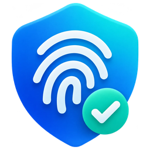

# Вход в Windows по отпечатку пальца: ZW111 + RP2040 + свой Credential Provider

[](https://github.com/teuchezh/zw111-windows-fingerprint-unlock/actions/workflows/build.yml)

🇬🇧 [English version](README.md)

Это «правильный» вариант: никакой эмуляции клавиатуры. На экране входа и блокировки
появляется своя плитка «Отпечаток пальца». Когда сканер ZW111 узнаёт палец, Windows
выполняет обычный интерактивный вход через LSA, как если бы вы ввели пароль.

```
 ┌──────────┐  UART 57600  ┌────────────┐  USB CDC (COM)  ┌──────────────────────────────┐
 │  ZW111   │◄────────────►│   RP2040   │◄───────────────►│ Windows: LogonUI             │
 │ шаблоны  │              │ K_dev,     │                 │   ZwCredProv.dll             │
 │ пальцев  │              │ K_auth     │                 │   K_pc, K_auth, E(пароль)    │
 └──────────┘              └────────────┘                 └──────────────────────────────┘
```

## Состав

| Путь | Что это |
|---|---|
| `firmware/` | Проект PlatformIO: прошивка для RP2040 (окружение `pico`) и ESP32-S3 (`esp32s3`). |
| `windows/credprov/` | Credential Provider: COM-DLL `ZwCredProv.dll`, грузится в LogonUI. |
| `windows/setup/` | `zwsetup.exe`: консольная утилита настройки, записи пальцев, проверки. |
| `windows/service/` | `ZwCredSvc.exe`: служба SYSTEM для входа в окнах Windows Security (по желанию). |
| `windows/ZwSetup/` | `ZwSetup.exe`: основное приложение настройки на .NET 8 + WPF-UI (стиль Fluent, навигация, тёмная и светлая темы, RU/EN). |
| `windows/gui/` | `zwsetup-gui.exe`: простое Win32-окно, запасной вариант без .NET. |
| `windows/common/` | Общий код: COM-порт, реестр + DPAPI, AES-GCM, протокол, таблица строк (RU/EN). |
| `windows/build/` | Собранные x64 `ZwCredProv.dll`, `zwsetup.exe`, `zwsetup-gui.exe` (mingw-w64). `ZwSetup.exe` берите из артефактов CI или релиза. |
| `tests/` | Проверка SHA-256/HMAC против Python `hashlib`. |

## Модель безопасности

Пароль никогда не лежит целиком ни в устройстве, ни в открытом виде на ПК.

- **Устройство** хранит два 32-байтных ключа: `K_dev` и `K_auth`.
- **ПК** хранит в `HKLM\SOFTWARE\ZwCredProv` (читать могут только SYSTEM и администраторы)
  DPAPI-блоб с `K_pc`, `K_auth` и паролем, зашифрованным AES-256-GCM ключом
  `K = SHA256("zwcp-key-v1" || K_dev || K_pc)`.
- Устройство отдаёт `K_dev` только после того, как:
  1. ПК доказал знание `K_auth`: ответил `HMAC(K_auth, "zwcp-host-v1" || nonce)` на свежий nonce устройства;
  2. приложенный палец совпал с одним из записанных шаблонов.
  `K_dev` передаётся замаскированным: `K_dev XOR HMAC(K_auth, "zwcp-wrap-v1" || nonce)`.
- Запись ключей, запись и удаление пальцев, полная очистка требуют **зажатой кнопки BOOTSEL** (на YD-RP2040 также USR).
  Программа на ПК не может незаметно перепрошить ключи или добавить чужой палец.
- Что это даёт:
  - украли только устройство: внутри нет пароля и нет `K_pc`, расшифровать нечего;
  - украли только диск ПК: без `K_dev` пароль не расшифровать;
  - вредоносная программа в сеансе пользователя: не прочитает ключ реестра (ACL), значит не сможет
    пройти проверку `K_auth` и выманить `K_dev`; пока LogonUI держит COM-порт открытым,
    порт ей вообще недоступен.
- Чего это **не** даёт: тот, у кого одновременно есть устройство **и** права администратора/SYSTEM
  на этом ПК, уже и так владеет машиной. Шаблоны пальцев хранятся внутри ZW111 и ПК не покидают.

## Железо

Проверено по вашим схемам: ZW111 с 6-пиновым разъёмом 1.0 мм и плата VCC-GND **YD-RP2040**.

| ZW111, пин разъёма | Сигнал | YD-RP2040 |
|---|---|---|
| 1 | V_Touch (3.3 В, питание сенсора касания) | 3V3 |
| 2 | TouchOut | GP2 (не обязательно, прошивка его не использует) |
| 3 | VCC (3.3 В) | 3V3 |
| 4 | TX | GP1 (UART0 RX) |
| 5 | RX | GP0 (UART0 TX) |
| 6 | GND | GND |

GP0 и GP1 на YD-RP2040 подписаны как USART0 TX/RX, это UART0, он же `Serial1` в Arduino-Pico.
Все провода на 3.3 В, ничего не переводить на 5 В. На ZW111 стоит RGB-подсветка кольца,
прошивка управляет ей командой 0x35 (дыхание синим во время ожидания пальца, красные вспышки при ошибке).

Кнопки YD-RP2040: **BOOT** и **USR** (GP24) обе принимаются как подтверждение физического присутствия
для привилегированных команд. USR удобнее: BOOT при сбросе уводит плату в режим прошивки.
Светодиод WS2812 на GP23 прошивка не трогает.

Другие платы: Pico подключается так же (3V3, GND, GP0, GP1), там подтверждение только кнопкой BOOTSEL.
ZW111 работает по протоколу ZFM/R30x, используется библиотека **Adafruit Fingerprint Sensor Library**,
пароль модуля по умолчанию `0x00000000`, скорость 57600.

## Шаг 1. Прошивка (PlatformIO)

Нужен PlatformIO (расширение VS Code или `pip install platformio`). Всё остальное
(ядро Arduino-Pico от earlephilhower, библиотека Adafruit Fingerprint) PlatformIO скачает сам
по `firmware/platformio.ini`.

```bash
cd firmware
pio run -e yd_rp2040 -t upload
pio device monitor
```

Окружение `yd_rp2040` стоит по умолчанию, для обычного Pico используйте `-e pico`.
Для первой прошивки зажмите BOOT и подключите USB: плата появится как диск, PlatformIO
зальёт UF2 сам. В мониторе (115200) команда `HELLO` должна ответить `OK ZWCP 1 0 0`
(версия 1, ключей нет, отпечатков 0).

Пины сенсора задаются флагами `ZW_SENSOR_TX` / `ZW_SENSOR_RX` в `platformio.ini`.
Другая плата RP2040 (Pico W, RP2040-Zero): смените `board`, пример закомментирован в ini.

Окружение `esp32s3` собирает ту же прошивку для ESP32-S3: Serial идёт через нативный USB,
вместо BOOTSEL используется кнопка BOOT (GPIO0), пины сенсора GPIO17/GPIO18. На железе не проверялось.
При `zwsetup provision` для S3 укажите `--usbid VID_303A&PID_1001`.

В контейнере, где готовился проект, не было доступа к GitHub и реестру PlatformIO, поэтому
`pio run` здесь не запускался. Код прошивки проверен компилятором на хосте с заглушками Arduino-API
для обоих окружений; расхождения возможны только в версиях библиотек, не в логике.

## Готовые сборки и CI

GitHub Actions на каждый пуш собирает прошивку (PlatformIO, все окружения), Windows-часть
(MSVC и mingw-w64), приложение `ZwSetup.exe` и гоняет проверку криптографии для C++ и C#. Готовые файлы лежат в артефактах каждого запуска
на вкладке Actions. При пуше тега вида `v1.0` создаётся релиз с архивом, в котором `ZwCredProv.dll`,
`zwsetup.exe`, `zwsetup-gui.exe`, `ZwSetup.exe` и UF2-файлы прошивки.

```bash
git tag v1.0
git push origin v1.0
```

## Шаг 2. Сборка Windows-части

Готовые бинарники уже лежат в `windows/build/`. Пересобрать можно так:

- **Visual Studio** (x64 Native Tools Command Prompt): `cd windows && build.bat`
- **mingw-w64** (Linux или MSYS2): `cd windows && make`

## Шаг 3. Настройка

### Вариант A: приложение `ZwSetup.exe` (рекомендуется)

Скачайте `ZwSetup.exe` из релиза или артефакта `windows-app` на вкладке Actions и положите рядом с
`ZwCredProv.dll`. Это самодостаточный exe на .NET 8, ничего устанавливать не нужно. Интерфейс в стиле
Fluent: слева разделы «Статус», «Настройка», «Отпечатки», «Журнал» и «Параметры», справа карточки.

1. **Настройка**: имя пользователя, домен, пароль дважды, карточка «1. Настроить устройство и пароль».
   Аккаунт Microsoft определяется автоматически. По запросу зажмите USR на плате и нажмите OK.
2. **Отпечатки**: слот и карточка «2. Записать палец», снова с зажатой USR.
3. **Настройка** → «3. Проверить»: приложите палец, программа расшифрует пароль и проверит его через LogonUser.
4. **Статус** → «Зарегистрировать DLL», затем Win+L.

В «Параметрах» язык (применяется и к плитке), тема окна, отладочный лог и удаление настроек.
Переключатель «Плитка на экране входа» на странице «Статус» временно скрывает плитку без удаления настроек.

Пересобрать: `dotnet publish windows/ZwSetup/ZwSetup.App -c Release` (нужен .NET 8 SDK; проект публикуется
как один самодостаточный файл для x64).

### Вариант B: окно `zwsetup-gui.exe` (без .NET)

Запустите `windows\build\zwsetup-gui.exe` (права администратора запросит сам, `ZwCredProv.dll`
должна лежать рядом). Дальше кнопки по порядку:

1. Заполните имя пользователя, домен (`.` для локальной учётной записи, `MicrosoftAccount` для аккаунта Microsoft),
   пароль дважды. Нажмите **«1. Настроить устройство и пароль»**, по запросу зажмите USR на плате и нажмите OK.
2. **«2. Записать палец в слот»** (слот 1), снова с зажатой USR, затем следуйте подсказкам в журнале.
3. **«3. Проверить»**: приложите палец, программа расшифрует пароль и проверит его через LogonUser.
4. **«Зарегистрировать DLL»**: копирует `ZwCredProv.dll` в System32 и регистрирует провайдер.
5. Win+L, на экране блокировки плитка «Отпечаток пальца».

«Обновить статус» показывает все COM-порты с USB-идентификаторами и состояние устройства.
Если порт занят монитором PlatformIO, статус так и скажет.
Выпадающий список языка переключает окно, консольную утилиту и плитку на экране входа
(сохраняется как `Lang` в реестре: `auto`, `ru` или `en`; `auto` следует языку интерфейса Windows).

### Вариант C: консоль `zwsetup.exe` (PowerShell от администратора)

```bat
cd windows\build
copy ZwCredProv.dll C:\Windows\System32\
regsvr32 C:\Windows\System32\ZwCredProv.dll
```

Полная настройка: новые ключи, прошивка их в устройство, пароль, запись в реестр.
Когда попросят, зажмите кнопку USR (или BOOT) на плате и нажмите Enter:

```bat
zwsetup provision --user ВашеИмя
```

Для аккаунта Microsoft: `zwsetup provision --user name@outlook.com --domain MicrosoftAccount`.
Для доменного: `--domain CORP`. Опции: `--port COM7` вместо автопоиска по USB ID,
`--finger 1` чтобы разрешить вход только пальцу из слота 1, `--debug` для лога
`C:\ProgramData\ZwCredProv\zwcredprov.log`.

Записать палец (зажав USR или BOOT):

```bat
zwsetup enroll --id 1
```

Проверить всю цепочку, не блокируя экран:

```bat
zwsetup test
```

`test` проходит рукопожатие, ждёт палец, расшифровывает пароль и проверяет его через `LogonUser`.
Если здесь всё «OK», нажмите Win+L: на экране блокировки появится плитка «Отпечаток пальца»,
приложите палец, вход произойдёт сам.

Прочие команды: `status`, `set-password` (после смены пароля Windows), `delete --id N`,
`disable` / `enable` (скрыть плитку, не удаляя настройки), `lang auto|ru|en`, `wipe`, `uninstall`.

Снять полностью:

```bat
zwsetup uninstall
regsvr32 /u C:\Windows\System32\ZwCredProv.dll
```

## Как это работает внутри

1. LogonUI загружает `ZwCredProv.dll` для сценариев `CPUS_LOGON` и `CPUS_UNLOCK_WORKSTATION`.
   Провайдер читает конфигурацию и через `ICredentialProviderSetUserArray` проверяет, что настроенный
   пользователь вообще есть на экране (на экране блокировки это только заблокированный пользователь).
2. Рабочий поток ищет COM-порт по USB ID платы (производитель `VID_2E8A`, у YD-RP2040 полный id `VID_2E8A&PID_800A`), шлёт `HELLO`, `NONCE`, `AUTH`.
3. Устройство включает подсветку и ждёт палец. При совпадении шлёт `MATCH <id> <conf> <wrapped K_dev>`.
4. Провайдер снимает маску, вычисляет `K`, расшифровывает пароль, вызывает `CredentialsChanged`.
   LogonUI переспрашивает `GetCredentialCount`, получает «автовход плиткой 0» и вызывает `GetSerialization`.
5. `GetSerialization` собирает `KERB_INTERACTIVE_UNLOCK_LOGON` (пароль защищён `CredProtect`),
   пакет аутентификации `Negotiate`. Пароль в памяти затирается сразу после упаковки.
6. Если LSA отверг вход (`ReportResult` с ошибкой), плитка показывает код ошибки и запускает новое рукопожатие.

Протокол устройства описан в шапке `firmware/src/main.cpp`.

## Подсветка кольца

Кольцо светится только пока Windows действительно ждёт палец: на экране входа или блокировки и во время
проверки или записи пальца. Когда вы вошли в систему, плата гасит кольцо сама: она видит, что Windows закрыла
COM-порт. Прошивка сама определяет команду подсветки: `0x3C` у ZW111 или `0x35` у сканеров R503.

Страница **«Подсветка»** в `ZwSetup.exe` настраивает эффект для каждого события: ожидание пальца, палец
распознан, ошибка, запись пальца, простой. Для каждого задаются режим (дыхание, мигание, горит, выключено,
плавно зажечь или погасить), цвет из семи и число повторов. Кнопка «Показать» проигрывает эффект 3 секунды
без сохранения. Настройки хранятся на плате.

«Подсвечивать ожидание не дольше» гасит кольцо через заданное число секунд ожидания, например если экран
блокировки висит всю ночь. Палец при этом по-прежнему принимается, а неверный палец снова включает подсветку.

## Отпечатки, блокировка и обновление прошивки

- **Страница «Отпечатки»** показывает занятые слоты сканера. Пальцу можно дать название (хранится на ПК),
  удалить его или записать новый: он попадёт в первый свободный слот.
- **Блокировка.** После 5 неверных пальцев подряд сканер 30 секунд не реагирует, и каждый следующий неверный
  палец блокирует его снова. Счётчик хранится во флеш-памяти платы, отключение платы его не сбрасывает.
  Плитка на экране входа показывает, сколько ждать.
- **Обновление прошивки из приложения.** «Параметры» → «Прошивка платы» показывает версии на плате и в
  приложении. «Обновить» просит зажать USR, перезагружает плату в загрузчик, копирует встроенный UF2 и ждёт,
  пока плата вернётся. Ключи, отпечатки и подсветка сохраняются. «Из файла…» прошивает любой UF2 для RP2040.
  Плату с прошивкой старше 1.1 в загрузчик переводят руками: отключить, зажать BOOT, подключить.
- **Без тихой перепрошивки.** Прошивка блокирует приём Arduino-Pico «открыть порт на 1200 бод и плата
  перезагрузится в загрузчик», поэтому ни одна программа на ПК не перепрошьёт плату без кнопки. Побочный эффект:
  `pio run -t upload` больше не перезагружает плату сам, держите BOOT при подключении или обновляйте из приложения.
- **Отклонённый вход.** Если Windows не приняла сохранённый пароль, обычно после его смены, на странице «Статус»
  появится предупреждение с кнопкой «Сменить пароль».
- Приложение само обновляет статус, когда плату подключают или отключают.

## Вход в окнах Windows Security (по желанию)

Chrome, Edge и другие программы перед показом сохранённых паролей просят подтвердить личность в окне
«Безопасность Windows». Переключатель **«Параметры» → «Вход в окнах Windows Security»** добавляет туда плитку
«Отпечаток пальца» в «Других вариантах».

В таких окнах провайдер работает от вашего имени и не может прочитать защищённые ключи, поэтому с платой говорит
небольшая служба **ZwCredSvc** от имени SYSTEM. Она отвечает только системному окну учётных данных
`%SystemRoot%\System32\CredentialUIBroker.exe`, запущенному от настроенной учётной записи, и только после
совпавшего пальца. Переключатель ставит службу в `%ProgramFiles%\ZwCredProv` и запускает её, выключение удаляет.
`ZwCredSvc.exe` должен лежать рядом с `ZwSetup.exe`.

**Риск:** программа, открывшая такое окно, получает ваш пароль Windows, ровно как если бы вы ввели его вручную.
Открыть такое окно может любая программа, поэтому прикладывайте палец только к окнам, которые ожидаете.
По умолчанию выключено. Окна с простым вводом имени и пароля, запросы повышения прав администратора и окна
с заранее заполненным пользователем не поддерживаются.

## Учётная запись Microsoft и вход по PIN

Если на экране входа Windows предлагает PIN и показывает полное имя, скорее всего это аккаунт Microsoft.
Тогда:

1. В настройке укажите домен `MicrosoftAccount`, а вместо имени пользователя почту аккаунта
   (`name@outlook.com`). Пароль нужен от аккаунта Microsoft, а **не PIN**.
2. В Windows 11 откройте Параметры → Учётные записи → Варианты входа и **выключите** переключатель
   «Для повышения безопасности разрешите вход Windows Hello только для учётных записей Майкрософт».
   Пока он включён, Windows отвергает любой вход по паролю, в том числе от провайдера.
3. Если в аккаунте Microsoft включён «беспарольный вход» (account.microsoft.com → Безопасность),
   пароля у аккаунта вообще нет, и вход по паролю невозможен. Отключите беспарольный режим или
   используйте локальную учётную запись.

Ошибка `0xC000006D` на плитке означает, что Windows не приняла пару имя/пароль: проверьте пункты выше
и затем «Сменить пароль» в окне настройки (или `zwsetup set-password`).

## Отладка

- Плитки нет: `zwsetup status` покажет, зарегистрирована ли DLL и найдено ли устройство;
  убедитесь, что учётная запись из `--user` есть на экране входа.
- Включите `--debug` при `provision` (или `Debug=1` в реестре) и смотрите
  `C:\ProgramData\ZwCredProv\zwcredprov.log`.
- Credential Provider можно отлаживать без перезагрузки: `Win+L` перезапускает LogonUI,
  но DLL остаётся загруженной в `LogonUI.exe` до его завершения; для замены DLL достаточно
  выйти из системы или перезагрузиться.
- Запасной вход всегда остаётся: стандартная плитка с паролем никуда не исчезает.

## ESP32-S3 вместо RP2040

Используйте окружение `esp32s3` (см. Шаг 1). Платформенные различия вынесены в блок
«platform glue» в начале `firmware/src/main.cpp`: источник случайных чисел, кнопка физического
присутствия и назначение пинов UART. Бонус S3: аппаратное шифрование флеша защищает `K_dev`
от чтения по USB; на RP2040 такой защиты нет, поэтому там особенно важна схема с разделённым секретом.
